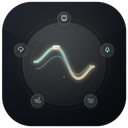

# 🎧 Atmos — Ambient Sound Generator (Windows & macOS)

<p align="center">
  
</p>

<p align="center">
  <b>Минималистичный генератор фоновых звуков и шумов для концентрации, релаксации и сна.</b><br>
  Работает прямо из системного трея Windows или Menu Bar macOS. 100% автономно, без интернета и рекламы.
</p>

<p align="center">
  
  
  
  
  
</p>

---

## ✨ Возможности

- 🌧 **7 атмосферных каналов звука:**
  - **Дождь** — *По крыше / Тропический / Ливень в лесу*
  - **Гроза** — *Далекий гром / Глубокие раскаты / Сильная гроза*
  - **Море и волны** — *Песчаный пляж / Каменный берег / Прибой о скалы*
  - **Ветер** — *Тихий день / Ветреный день / Порывы ветра*
  - **Лес и природа** — *Ночной лес / Лес и пение птиц / Лесной ручей*
  - **Костер** — *Тление углей / Треск костра / Яркое пламя*
  - **Поезд** — *Мягкий стук / Из вагона / Скоростной экспресс*

- 🎛 **Индивидуальная настройка каждого канала:**
  - Плавная регулировка громкости для каждого звука.
  - Быстрое переключение интенсивности и текстуры звучания в 1 клик.
  - Бесшовное зацикливание (*Seamless Equal-Power Crossfade AudioBuffer*) без микро-пауз и щелчков.

- 🎚 **Управление звуком колесиком мыши:**
  - Прокрутка над дорожкой регулирует громкость конкретного трека.
  - Прокрутка над общей панелью или фоном виджета регулирует мастер-громкость.

- 🎨 **Нативный кроссплатформенный интерфейс:**
  - **Windows 11**: Нативное системное скругление углов DWM (*DWMWCP_ROUND*) и Windows Acrylic glassmorphism.
  - **macOS**: Нативное размытие матового стекла (*NSVisualEffectMaterial::HudWindow*), размещение в строке меню (Menu Bar Status Item) и скрытие из Dock (Accessory App).
  - Поддержка двух тем: **Размытие (Frosted Glass)** и **Классическая темная тема**.
  - 4 гармоничные цветовые схемы: Янтарный, Мятный, Лазурный, Розовый.
  - Живая пульсация активных звуков и визуализатор эквалайзера.

- ⚡ **Быстрые пресеты в 1 клик:**
  - **ЛКМ** по названию пресета в шапке — следующий пресет.
  - **ПКМ** — предыдущий пресет.
  - Готовые пресеты: *«Спокойная атмосфера»*, *«Ночной экспресс»*, *«Гроза за окном»*, *«Лесной ручей»*, *«Уют у камина»*, *«Морской бриз»*.

- ⏱ **Таймер сна (Sleep Timer):**
  - Автоматическое выключение через 15, 30, 45 или 60 минут с плавным затуханием звука.

- 🛡 **Безопасность слуха:**
  - Стартовая мастер-громкость выставлена на комфортные 40% без риска оглушения.

- 📌 **Удобство трея / меню-бара:**
  - Кнопка `<` (chevron) сворачивает окно в системный трей (Windows) или Menu Bar (macOS).
  - Красная кнопка `✕` полностью завершает процесс приложения.
  - Контекстное меню иконки с быстрым доступом.

---

## 🚀 Установка

### Для macOS (.dmg)
1. Скачайте **`Atmos.dmg`** из раздела [**Releases**](../../releases/latest).
2. Откройте DMG-образ и перетащите иконку **Atmos** в папку **Applications** («Программы»).
3. Приложение появится в верхней строке меню (Menu Bar) и готово к использованию на **Apple Silicon (M1/M2/M3/M4)** и **Intel Mac**.

### Для Windows (.exe)
- **Установщик (Рекомендуется)**: Скачайте **`Atmos_Setup_v0.1.0.exe`** — мастер установки с выбором папки и созданием ярлыков.
- **Портативная версия**: Скачайте **`Atmos_Portable_v0.1.0.exe`** — запускается без установки.

---

## ⌨ Горячие клавиши и управление

| Действие | Управление |
|---|---|
| **Свернуть в трей** | Клик по стрелке `<` в левом верхнем углу |
| **Закрыть приложение** | Клик по красному крестику `✕` |
| **Следующий пресет** | **ЛКМ** по названию пресета в шапке |
| **Предыдущий пресет** | **ПКМ** по названию пресета в шапке |
| **Громкость звука** | Колесико мыши над карточкой звука |
| **Мастер-громкость** | Колесико мыши над нижней панелью |
| **Смена интенсивности** | Клик по бейджу режима рядом со слайдером |
| **Таймер сна** | Иконка секундомера в правом нижнем углу |
| **Тема и акцент** | Иконка палитры в правом верхнем углу |

---

## 🛠 Сборка из исходников

### Требования
- [Node.js](https://nodejs.org/) (версия 18+)
- [Rust](https://rustup.rs/) (версия 1.77+)
- Visual Studio Build Tools с компонентом C++ x64/x86 build tools

### Шаги

```bash
# 1. Клонировать репозиторий
git clone https://github.com/paraxyoz/atmos.git
cd atmos

# 2. Установить зависимости npm
npm install

# 3. Запустить в режиме разработки
npm run tauri dev

# 4. Собрать релизный установщик
npm run tauri build
```

Собранный установщик будет находиться в:
`src-tauri/target/release/bundle/nsis/Atmos_0.1.0_x64-setup.exe`

---

## 📄 Лицензия

Проект распространяется под свободной лицензией **[MIT](LICENSE)**.
Автор: [@paraxyoz](https://github.com/paraxyoz).
